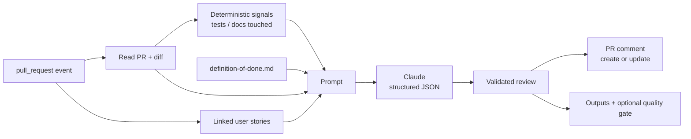

# AI Sprint Assistant

> A **GitHub Action** that reviews every pull request against its **user story** and your team's **Definition of Done** using **Claude**, and posts a Scrum-friendly checklist as a PR comment.


## Why this project

In Scrum, the **Definition of Done** is the team's quality contract — but in practice nobody re-reads it on every pull request, and reviewers rarely check the change against the user story's acceptance criteria. This action does that first pass automatically in the pipeline, so humans can focus the review on design and edge cases.

## What it does (v0.1)

On every pull request it:

1. Reads the PR, its diff and the **linked user stories** (`Closes #12`, `Fixes #3`, `Refs #7`…)
2. Loads your **Definition of Done** from `.github/definition-of-done.md` (or a sensible default)
3. Runs **automatic checks without AI**: PR description, linked user story, acceptance criteria in the story, tests for code changes and recommended PR size
4. Asks Claude for a structured review: summary, change type, story alignment, **every DoD item as met / not met / unknown with evidence**, risks and suggested tests
5. Posts **one comment** on the PR and updates it on every push (no comment spam)
6. Exposes `change-type`, `dod-met`, `dod-total` and `checks-passed` as outputs and can **fail the check** on required checks or below a DoD threshold

It also ships **Scrum templates**: a user story issue form (story, acceptance criteria, story points) and a PR template with `Closes #`.

Example comment:

```markdown
## 🤖 AI Sprint Assistant
**Type:** `feature` · **Definition of Done:** 3/5 met · **Story:** #12

### Automatic checks ✅
- [x] PR has a description — provided
- [x] Linked to a user story (Closes #N) — #12
- [x] User story has acceptance criteria — 2 criteria
- [x] Code changes include tests — 1 test file(s)
- [ ] Small enough to review (≤ 400 lines) _(recommended)_ — 520 changed lines

### User story
⚠️ Partially covers the user story — CSV export is done, XLSX is missing

### Definition of Done
| | Item | Evidence |
|---|---|---|
| ✅ | New or changed behaviour is covered by automated tests | ExportServiceTests.cs added |
| ❌ | README or docs are updated when ... | No docs changed |
| ❔ | All acceptance criteria of the linked user story are met | XLSX not visible in the diff |
```

The example illustrates the format; real content depends on your PR.

## Architecture



## Usage

1. Add the `ANTHROPIC_API_KEY` secret to your repository.
2. Optionally add `.github/definition-of-done.md` with your team's checklist (`- [ ] item` lines).
3. Add the workflow:

```yaml
name: AI Sprint Assistant
on:
  pull_request:
    types: [opened, synchronize, reopened, ready_for_review]

permissions:
  contents: read
  pull-requests: write
  issues: read

jobs:
  review:
    runs-on: ubuntu-latest
    steps:
      - uses: actions/checkout@v4
      - uses: xavieroldan/ai-sprint-assistant@v0.1.0
        with:
          anthropic-api-key: ${{ secrets.ANTHROPIC_API_KEY }}
```

### Inputs

| Input | Default | Description |
|---|---|---|
| `anthropic-api-key` | `""` | Anthropic API key; if empty only the automatic checks run |
| `github-token` | `${{ github.token }}` | Token to read the PR and post the comment |
| `model` | `claude-haiku-4-5-20251001` | Claude model |
| `dod-path` | `.github/definition-of-done.md` | Definition of Done checklist |
| `max-diff-chars` | `60000` | Diff size sent to the model (cost control) |
| `fail-below-dod` | `0` (off) | Fail when the share of DoD items met is below this value, e.g. `0.6` |
| `require-tests` | `true` | Automatic check: code changes must include tests |
| `require-linked-issue` | `true` | Automatic check: PR must close a story with acceptance criteria |
| `max-changed-lines` | `400` | Automatic check (recommendation): maximum PR size |
| `fail-on-checks` | `false` | Fail when a required automatic check fails |
| `skip-drafts` | `true` | Skip draft pull requests |

### Outputs

`change-type` · `dod-met` · `dod-total` · `checks-passed`

## Design decisions

- **No dependencies**: plain Node.js 24 with `fetch`, so there is no build step and nothing to bundle or audit.
- **Facts before AI**: test and documentation changes are detected in code and given to the model as facts, which reduces hallucinated "tests added".
- **Defensive parsing**: the model answer is validated; unknown values fall back to safe defaults and every DoD item is always reported.
- **Works without AI**: without the secret (forks) or if Claude fails, the automatic checks are still posted and the job does not break.
- **Humans decide**: the comment states that AI output can be wrong; the quality gate is opt-in.

## Development

```bash
npm test   # 37 tests with mocked GitHub and Anthropic APIs, no dependencies
```

This repository reviews its own pull requests with the action (`.github/workflows/sprint-assistant.yml`).

## Roadmap

- [x] PR review against user story and Definition of Done
- [x] Single updatable comment, outputs and optional quality gate
- [x] Automatic checks without AI and Scrum issue/PR templates
- [x] Tests and dogfooding workflow
- [ ] Sprint Review report when a milestone is closed (done vs not done, velocity)
- [ ] Release notes grouped by change type on merge
- [ ] Retrospective topics from blocked or heavily reworked PRs
- [ ] Publish on GitHub Marketplace

## Tech stack

GitHub Actions · Node.js 20 · Claude API (Anthropic) · GitHub REST API · Prompt engineering · node:test · actionlint

## What this project demonstrates

- Bringing **Scrum practices** (DoD, user stories) into the **CI/CD pipeline**
- **Applied AI** with structured, validated output and cost control
- A production-minded GitHub Action: tested, dependency-free and safe by default

## Author

**Xavier Roldán** — Senior Developer & Team Lead
[xavierroldan.com](https://xavierroldan.com) · [LinkedIn](https://www.linkedin.com/in/xavierroldan/)

## License

MIT
